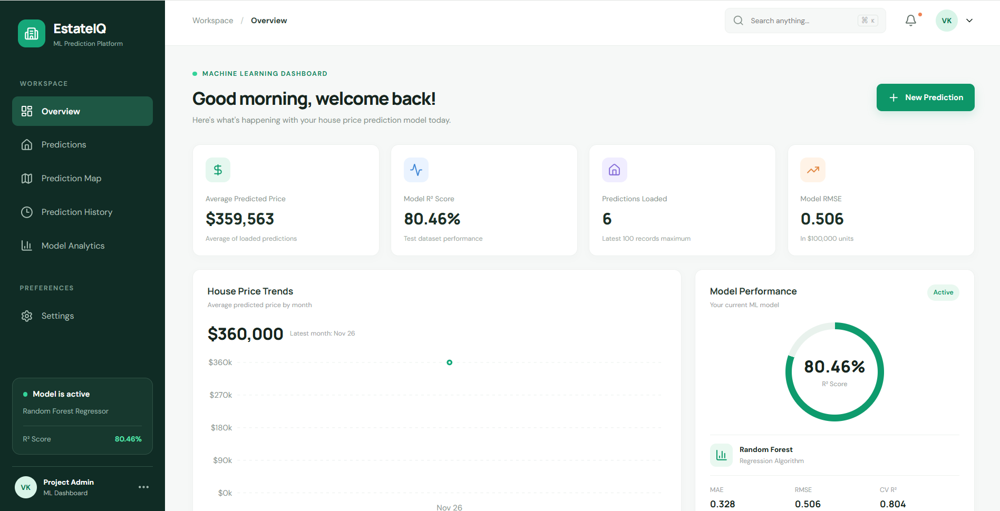
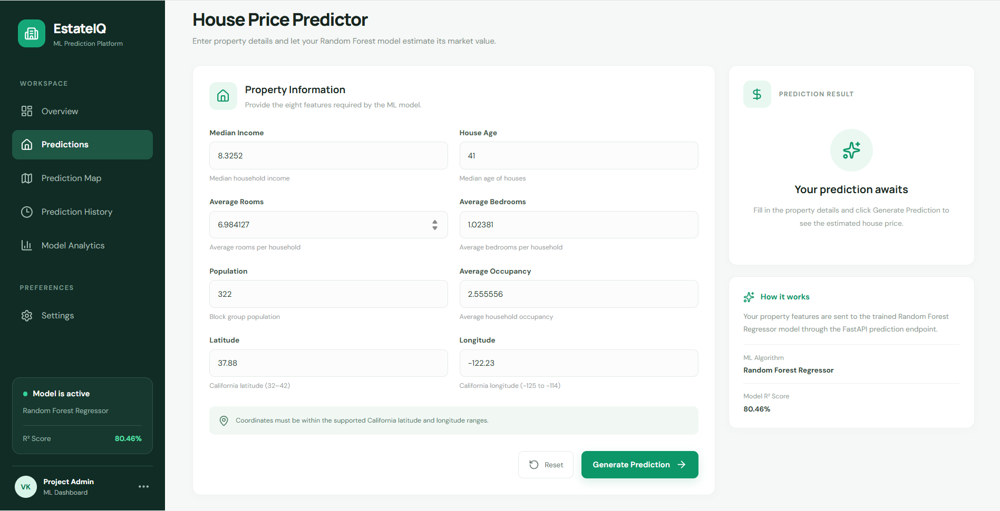
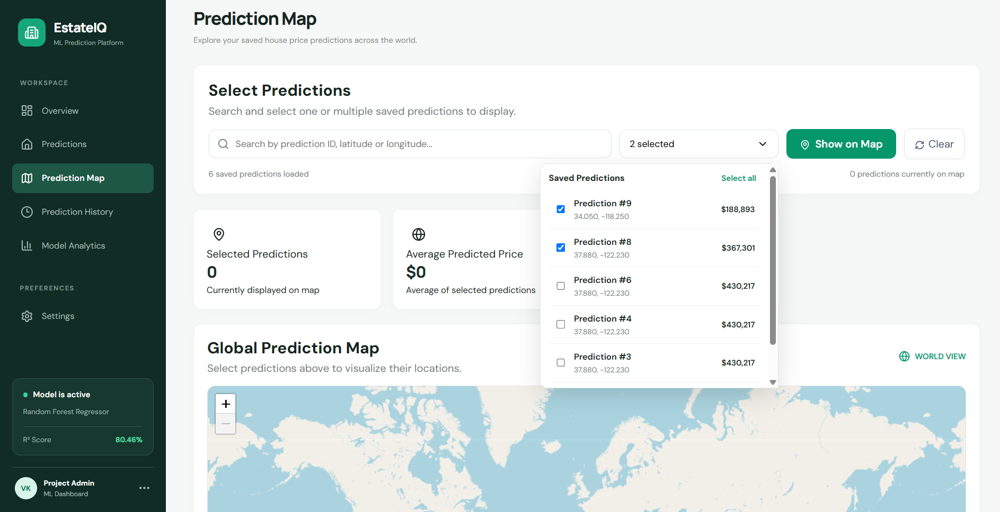
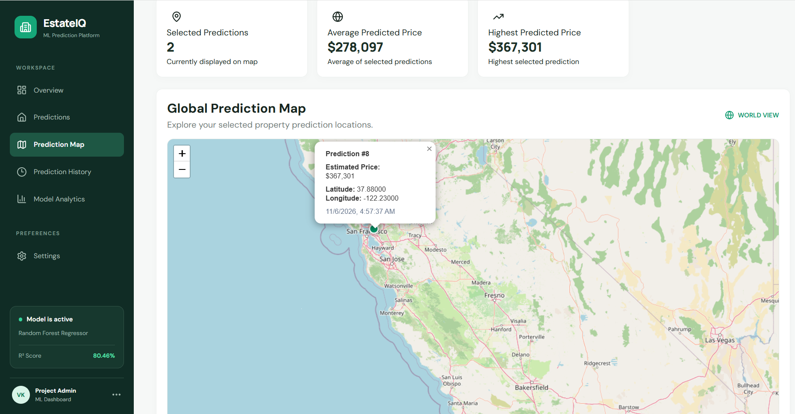
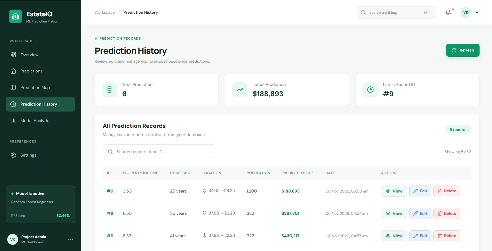
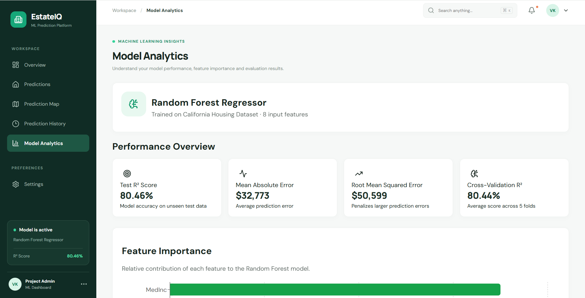
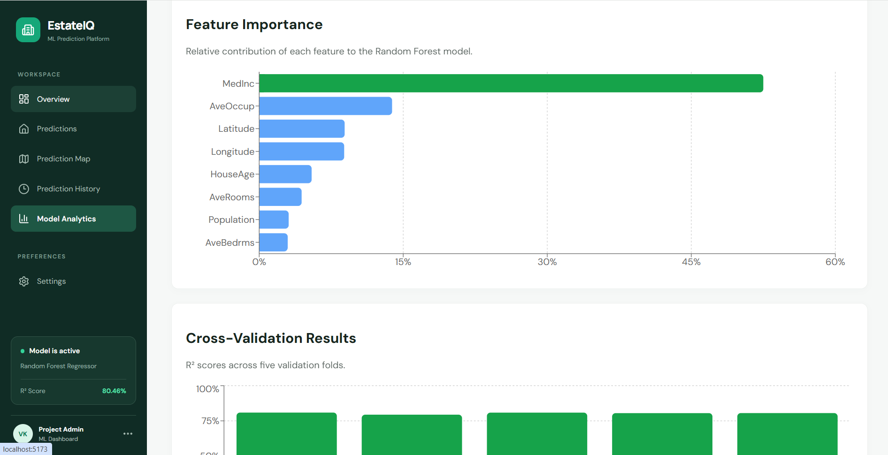
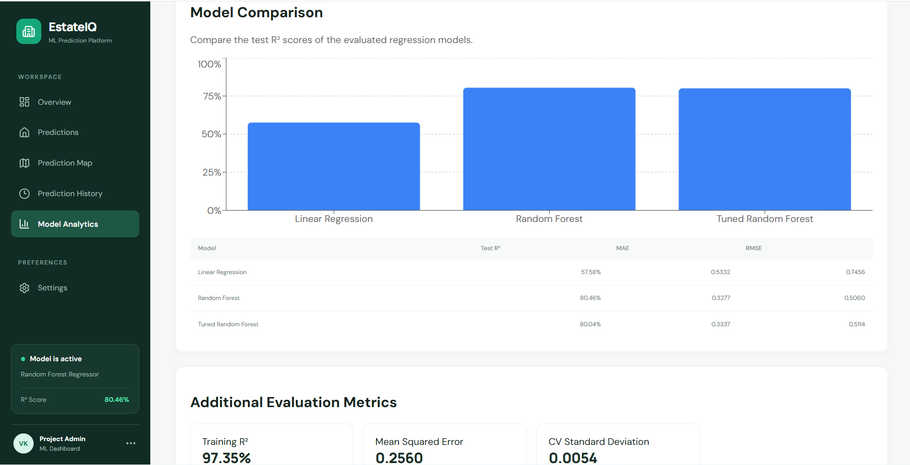
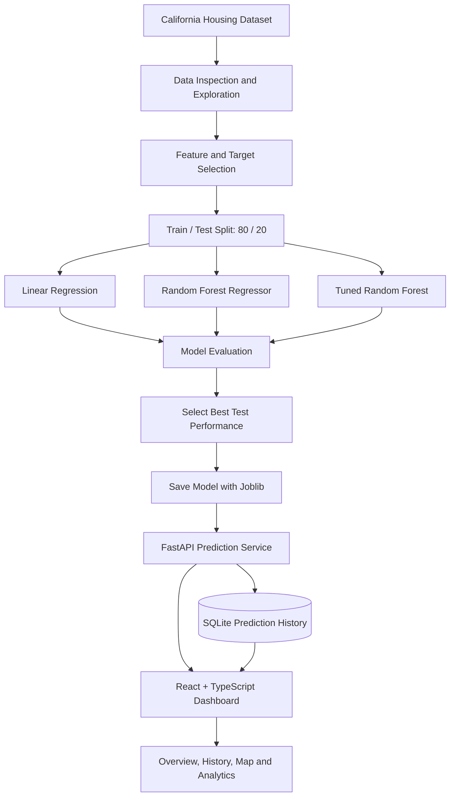
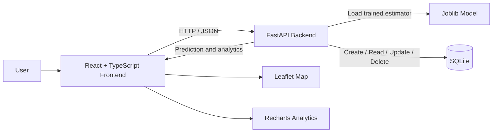

<div align="center">

# EstateIQ

### Machine Learning–Powered House Price Prediction Platform

A full-stack machine learning application that turns property characteristics into estimated house values, with prediction history, interactive geospatial exploration, and model-performance analytics.

<br />


**[Repository](https://github.com/vishal-debug310/EstateIQ)**

</div>

---

## Overview

EstateIQ is an end-to-end house price prediction platform built around a trained **Random Forest Regressor**. Users enter eight property and location features, receive an estimated house value, and can revisit or manage saved predictions.

The application combines a machine learning workflow with a practical web product:

- A trained regression model using the California Housing dataset.
- A FastAPI service that loads the saved model and exposes prediction and analytics endpoints.
- A React + TypeScript dashboard for submitting and exploring predictions.
- Persistent prediction records stored in SQLite.
- An interactive Leaflet map with selectable predictions, clustered markers, and detail popups.
- Model evaluation views covering error metrics, cross-validation, feature importance, and model comparison.

> **Dataset scope:** The model is trained on the California Housing dataset. Its predictions are based on that dataset's feature distribution and should not be interpreted as estimates for arbitrary locations or as professional property valuations.

## Product Screenshots

The screenshots below are stored in `docs/screenshots/` in this repository. They are full-resolution captures so that dashboard labels, charts, and map details remain readable on GitHub.

### 1. Overview Dashboard

A quick view of saved predictions, average predicted price, model score, price trends, and current model status.



### 2. House Price Prediction

Enter the eight features expected by the trained model and generate a prediction through the backend API.



### 3. Prediction Map — Select Records

Search saved predictions by ID or coordinates, select multiple records, and choose which predictions to display.



### 4. Prediction Map — Interactive Results

Explore selected prediction locations on the map. Markers can be clustered at lower zoom levels and expanded as the map is zoomed in. Select a marker to inspect its prediction details.



### 5. Prediction History

Review stored prediction records and manage them through the history interface.



### 6. Model Analytics — Performance Overview

Inspect the selected model's evaluation metrics and feature importance.



### 7. Feature Importance and Cross-Validation

Understand which input features contribute most to the Random Forest model and how its R² score behaves across validation folds.



### 8. Model Comparison

Compare Linear Regression, Random Forest, and tuned Random Forest results using test-set metrics.



---

## Key Features

| Area | Capabilities |
|---|---|
| Prediction | Eight-feature input form, API-based inference, formatted estimated price |
| Overview | Prediction count, average predicted price, monthly trend, model performance summary |
| Prediction history | Search, pagination, record details, edit, and delete |
| Geospatial view | Global map canvas, search and multi-select, fit-to-markers, marker clustering, spiderfy, popups |
| Model analytics | Test metrics, cross-validation scores, feature importance, model comparison, additional evaluation metrics |
| Backend | FastAPI endpoints, model loaded once, SQLite persistence, CORS configuration |

## Machine Learning Workflow



### Dataset and input features

EstateIQ uses the **California Housing dataset** with 20,640 records and eight input features.

| Feature | Meaning |
|---|---|
| `MedInc` | Median income in the block group |
| `HouseAge` | Median house age |
| `AveRooms` | Average rooms per household |
| `AveBedrms` | Average bedrooms per household |
| `Population` | Block group population |
| `AveOccup` | Average household occupancy |
| `Latitude` | Geographic latitude |
| `Longitude` | Geographic longitude |

**Target:** `MedHouseVal`, expressed in units of $100,000. The API converts the model output into a USD estimate for display.

### Model evaluation

The following results are from the project's held-out test set and cross-validation runs.

| Model | Test R² | MAE | RMSE |
|---|---:|---:|---:|
| Linear Regression | 0.5758 | 0.5332 | 0.7456 |
| **Random Forest (selected)** | **0.8046** | **0.3277** | **0.5060** |
| Tuned Random Forest | 0.8004 | 0.3337 | 0.5114 |

Additional evaluation for the selected Random Forest model:

| Metric | Result |
|---|---:|
| Training R² | 0.9735 |
| Test R² | 0.8046 |
| Mean cross-validation R² | 0.8044 |
| Cross-validation standard deviation | 0.0054 |

**Why Random Forest was selected:** it achieved the strongest test-set R² and lowest MAE/RMSE among the evaluated models. The difference between training and test R² also indicates some overfitting, which is worth considering when interpreting predictions.

## Application Architecture



### Technology Stack

**Machine Learning**
- Python
- pandas and NumPy
- scikit-learn
- Joblib
- Jupyter Notebook

**Backend**
- FastAPI
- Pydantic
- SQLAlchemy
- SQLite
- Uvicorn

**Frontend**
- React 18
- TypeScript
- Vite
- React Router
- Axios
- Recharts
- Leaflet
- React Leaflet
- `react-leaflet-cluster`
- Lucide React

## Backend API

The backend exposes the following endpoints:

| Method | Endpoint | Purpose |
|---|---|---|
| `GET` | `/` | API welcome / status |
| `GET` | `/health` | Health check |
| `GET` | `/model-info` | Model information |
| `GET` | `/model-analytics` | Evaluation metrics, feature importance, and model comparison |
| `POST` | `/predict` | Generate and save a house price prediction |
| `GET` | `/predictions` | Retrieve saved predictions with pagination |
| `GET` | `/predictions/{prediction_id}` | Retrieve one prediction |
| `PUT` | `/predictions/{prediction_id}` | Update a saved prediction |
| `DELETE` | `/predictions/{prediction_id}` | Delete a saved prediction |

Interactive API documentation is available through FastAPI's Swagger UI at `/docs` when the backend is running.

## Project Structure

```text
EstateIQ/
│
├── app/
│   ├── __init__.py
│   ├── main.py                 # FastAPI application and routes
│   ├── schemas.py              # Request and response schemas
│   ├── predictor.py            # Model loading and prediction logic
│   ├── database.py             # Database connection and session setup
│   └── models.py               # SQLAlchemy database models
│
├── dataset/                    # Dataset files
├── models/
│   └── house_price_model.joblib
│
├── notebooks/
│   └── exploratory_analysis.ipynb
│
├── src/
│   ├── preprocessing.py        # Data preparation
│   ├── train.py                # Model training
│   └── evaluate.py             # Model evaluation
│
├── tests/
│   └── test_api.py             # API tests
│
├── logs/                       # Runtime logs (if enabled)
├── frontend/
│   ├── src/
│   │   ├── components/
│   │   ├── pages/
│   │   ├── services/
│   │   ├── types/
│   │   └── ...
│   ├── package.json
│   └── ...
│
├── requirements.txt
├── README.md
└── .gitignore
```

## Run Locally

### Prerequisites

- Python 3.13 (or a compatible Python version supported by the installed dependencies)
- Node.js and npm
- Git

### 1. Clone the repository

```bash
git clone https://github.com/vishal-debug310/EstateIQ.git
cd EstateIQ
```

### 2. Set up the backend

Create and activate a virtual environment:

**Windows PowerShell**
```powershell
python -m venv venv
.\venv\Scripts\Activate.ps1
```

Install Python dependencies:

```powershell
pip install -r requirements.txt
```

Start the API from the project root:

```powershell
uvicorn app.main:app --reload
```

Backend:
- API: `http://127.0.0.1:8000`
- Swagger documentation: `http://127.0.0.1:8000/docs`

### 3. Set up the frontend

Open a second terminal:

```powershell
cd frontend
npm install
npm run dev
```

Open the Vite URL shown in the terminal (normally `http://localhost:5173`).

### 4. Verify the application

1. Open the frontend in your browser.
2. Check that the backend health endpoint responds.
3. Enter property features on the Predictions page.
4. Generate a prediction and confirm it appears in Prediction History.
5. Select saved records on Prediction Map and display them.
6. Open Model Analytics to inspect the model metrics and charts.

> **Model artifact:** The API expects the trained model at `models/house_price_model.joblib`. If the artifact is not present in your clone, train the model using the project's training workflow before starting prediction requests.

## Prediction Flow

1. The user enters the eight supported property features in the React form.
2. The frontend validates and converts the input values to numbers.
3. Axios sends the feature payload to `POST /predict`.
4. FastAPI validates the request using the API schema.
5. The predictor creates a feature DataFrame in the expected model input order and runs inference with the saved Random Forest model.
6. The model output is converted from the dataset's $100,000 target units into a USD estimate.
7. The prediction and input features are persisted in SQLite.
8. The API returns the prediction result to the frontend.
9. The dashboard refreshes its overview, history, and map data from the API.

## Engineering Highlights

- **Reusable inference layer:** the trained model is loaded once by the backend rather than reloaded for every request.
- **Typed frontend contracts:** TypeScript interfaces describe house features, prediction results, and history records.
- **Persistent CRUD workflow:** predictions are stored and can be retrieved, edited, and deleted.
- **Data-driven analytics:** dashboard history and model analytics are fetched from backend endpoints.
- **Geospatial visualization:** saved latitude/longitude values are used for map markers; clustering keeps nearby markers manageable at wider zoom levels.
- **Model evaluation beyond one score:** test-set error metrics are presented alongside cross-validation results, feature importance, and model comparisons.

## Future Improvements

- Add authentication, user-specific prediction history, and role-based access.
- Support larger history queries with server-side filtering and export.
- Add automated model retraining and model-version tracking.
- Introduce stronger input validation and out-of-distribution warnings.
- Add deployment configuration, CI checks, and production monitoring.
- Evaluate additional models and explainability techniques.

## Limitations and Responsible Use

- The model is trained on California Housing data; it is not a universal real-estate valuation model.
- Predictions are estimates, not appraisals, offers, or financial advice.
- Model performance on the test split does not guarantee performance on new regions or future market conditions.
- The current map visualizes the coordinates attached to saved predictions; the global basemap does not imply global model coverage.

## Author

**EstateIQ Project**

- GitHub: [vishal-debug310](https://github.com/vishal-debug310)
- Repository: [EstateIQ](https://github.com/vishal-debug310/EstateIQ)

---

<div align="center">

**Built with machine learning, thoughtful engineering, and a focus on useful data visualization.**

If you find this project useful, consider giving the repository a ⭐.

</div>
